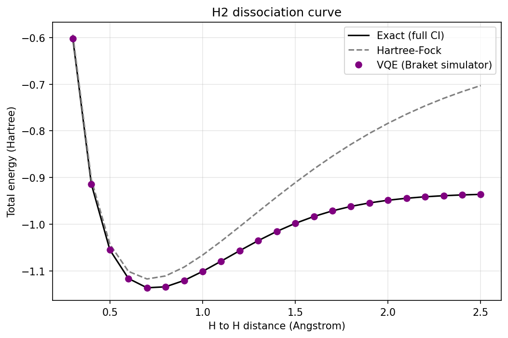

# VQE for the H2 molecule on Amazon Braket

A variational quantum eigensolver (VQE) that computes the ground state energy of the hydrogen molecule at 22 bond lengths and compares it with exact classical results. Built as part of a literature review project on quantum computing in biomedical research.

## What it does
1. Builds the H2 qubit Hamiltonian with PySCF and OpenFermion (STO-3G basis, reduced from 4 to 2 qubits using symmetries).
2. Computes the exact ground state energy (full CI) as a reference.
3. Runs VQE with a 4 parameter circuit (RY, CNOT, RY) on the Amazon Braket local simulator, optimized with COBYLA.
4. Repeats for H to H distances from 0.3 to 2.5 Angstrom and plots the dissociation curve.

## Results
| Quantity | Value |
|---|---|
| Lowest energy on the grid | -1.136189 Ha at 0.7 Angstrom |
| Largest VQE error vs exact | 1.9e-05 Ha |
| Hartree-Fock energy at 2.5 Angstrom | -0.702944 Ha (exact: -0.936055 Ha) |

VQE follows the exact curve at every distance, while Hartree-Fock becomes increasingly inaccurate as the bond stretches.

## Run it
Open the notebook in Google Colab and run all cells, or install locally:

    pip install -r requirements.txt

## Limitations
- All runs use a noise free simulator. Nothing was run on quantum hardware.
- H2 is a benchmark molecule for validating the method. It is not a drug molecule.
- A 2 qubit problem can be solved exactly on a classical computer, so this shows that the method works, not a quantum advantage.

## References
- Peruzzo et al., "A variational eigenvalue solver on a photonic quantum processor", Nature Communications (2014)
- O'Malley et al., "Scalable quantum simulation of molecular energies", Physical Review X (2016)
